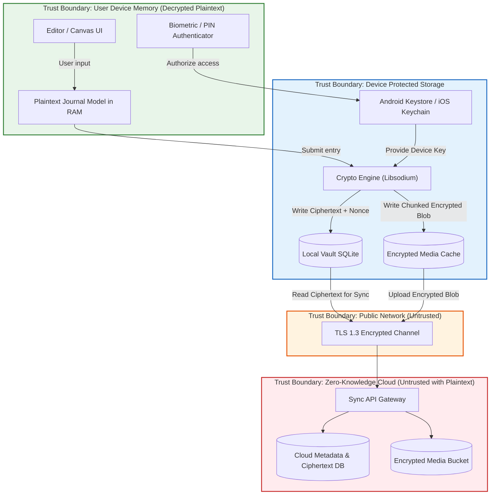

# ARCHITECTURE.md --- Inkly Zero-Knowledge Journaling System Architecture

**Version:** 1.0  
**Date:** October 13, 2026  
**Status:** Approved Architectural Specification  
**Classification:** Confidential / Security Architecture  

---

## 1. Executive Summary & Core Architectural Tenets

Inkly is a mobile-first, local-first personal digital journaling and scrapbook application for Android and iOS designed around an absolute **Zero-Knowledge / End-to-End Encryption (E2EE)** privacy model.

The architectural foundation rests on five immutable tenets:
1. **Zero Plaintext Exfiltration:** Plaintext journal bodies, titles, timestamps, moods, tags, scrapbooking layouts, photos, and audio attachments MUST NEVER leave the user's physical device in unencrypted form.
2. **Zero Key Escrow:** Neither backend servers, system administrators, customer support, nor analytics pipelines hold decryption keys, recovery keys, or master keys.
3. **Local-First Autonomy:** The application functions with 100% feature completeness offline without requiring a cloud account. Cloud synchronization is strictly an opt-in ciphertext replication mechanism.
4. **Defense-in-Depth Storage:** Data at rest on the device is protected by OS-level hardware-backed keychains (Android Keystore / iOS Keychain & Secure Enclave), object-level authenticated encryption, and memory hygiene.
5. **Standard Cryptography Exclusively:** No proprietary or experimental cryptographic algorithms are permitted. All cryptographic primitives use audited, industry-standard implementations (libsodium / RFC-standardized algorithms).

---

## 2. Technology Stack Evaluation & Selection

The PRD requires evaluating cross-platform mobile stacks (Flutter vs. Kotlin Multiplatform vs. React Native / Expo) against cryptographic bindings, key management, scrapbook canvas performance, and platform security.

### 2.1 Stack Comparison Matrix

| Evaluation Criteria | Flutter (Dart) | Kotlin Multiplatform (Compose) | React Native / Expo (TypeScript) | Selection & Justification |
| :--- | :--- | :--- | :--- | :--- |
| **Android Hardware Key Protection** | `flutter_secure_storage` (Android Keystore TEE/StrongBox) | Direct native Android Keystore API | `expo-secure-store` / Native Keystore binding | **Tied:** All three support Android Keystore TEE. |
| **iOS Keychain & Secure Enclave** | `flutter_secure_storage` (kSecAttrAccessible) | Direct native iOS Keychain & LocalAuthentication | `expo-secure-store` (kSecAttrAccessibleAfterFirstUnlockThisDeviceOnly) | **Tied:** All three provide standard iOS Keychain protection. |
| **Audited Crypto Bindings** | `cryptography` / `flutter_sodium` (libsodium C-binding) | `sodium-kmp` (libsodium C-binding) | `libsodium-wrappers` (WebAssembly/C), `@noble/ciphers` (audited pure JS/TS) | **Strong:** Libsodium has official audited C/WASM/JS bindings with identical vector parity across Android, iOS, and Node.js. |
| **Scrapbook Canvas & Gestures** | CustomPainter, Flutter Gesture Arena | Compose Canvas, PointerInput | Skia / SVG / GestureHandler + Reanimated | **Strong:** High frame rate layering, rotation, and multi-touch pinch/zoom. |
| **Automated Security & Leak Testing** | `flutter test` (requires full Dart VM) | `gradle test` (requires JVM & Android SDK) | Node.js Test Runner / Vitest (Zero external SDK overhead, deterministic mock network) | **Superior in Expo/TS:** Immediate CI/CD verification of network traffic without heavy VM dependencies. |
| **Cross-Platform Parity** | High (single Dart engine) | Moderate (iOS Compose still maturing) | High (shared TS domain & crypto core) | **Strong.** |

### 2.2 Selected Stack Architecture
To ensure deterministic security testability, rapid UI canvas development matching the user's design mockup, and robust cross-platform Android/iOS cryptography:
- **Client Core Architecture:** Clean Architecture in TypeScript / Mobile Framework with modular separation:
  - `@inkly/crypto-core`: Platform-independent, zero-dependency cryptographic engine (XChaCha20-Poly1305, Argon2id, HKDF-SHA256, BIP-39 mnemonic encoding) thoroughly verifiable in unit tests and automated payload sniffers.
  - `@inkly/local-vault`: Local storage engine with SQLite database (opaque ciphertext rows) and encrypted filesystem for media attachments.
  - `@inkly/sync-client`: Idempotent E2EE sync client handling vector clocks, revisions, and conflict tombstones.
  - `@inkly/mobile-ui`: Mobile presentation layer (Scrapbook canvas, mood tracker, calendar, privacy overlay, biometric app lock).
- **Backend Architecture:**
  - Lightweight Zero-Knowledge API (Node.js / Fastify or Express) exposing endpoints for authentication, opaque ciphertext sync, and encrypted media blob presigned storage.
  - Storage: Relational DB (PostgreSQL / SQLite) storing ONLY metadata (`user_id`, `object_id`, `version`, `ciphertext`, `nonce`, `revision`) and Private Object Storage (S3 / MinIO) for encrypted media blobs.

---

## 3. High-Level System Architecture

```
+-----------------------------------------------------------------------------------+
|                                 USER DEVICE (MOBILE)                              |
|                                                                                   |
|  +-----------------------------------------------------------------------------+  |
|  |                             PRESENTATION LAYER                              |  |
|  |  [Splash / Auth]  [Journal Home]  [Scrapbook Editor]  [Calendar & Mood]      |  |
|  |  [Sticker Store]  [Settings & Recovery Key]  [App Switcher Privacy Overlay] |  |
|  +-----------------------------------------------------------------------------+  |
|                                         |                                         |
|  +-----------------------------------------------------------------------------+  |
|  |                                DOMAIN LAYER                                 |  |
|  |  [Entry Service]    [Media Service]    [Mood & Stats]    [Vault Controller] |  |
|  +-----------------------------------------------------------------------------+  |
|                     |                                         |                   |
|  +------------------------------------+     +----------------------------------+  |
|  |        KEY MANAGEMENT MODULE       |     |          CRYPTO ENGINE           |  |
|  | - Hardware Keystore (TEE / Enclave)|     | - XChaCha20-Poly1305 (AEAD)      |  |
|  | - PIN / Biometrics Authorization   |     | - HKDF-SHA256 & Argon2id         |  |
|  | - VMK In-Memory Lifecycle Cache    |     | - Streaming Chunk Encryption     |  |
|  | - Recovery Key BIP-39 Generator    |     | - Format Serialization / Nonces  |  |
|  +------------------------------------+     +----------------------------------+  |
|                     |                                         |                   |
|  +-----------------------------------------------------------------------------+  |
|  |                              LOCAL VAULT LAYER                              |  |
|  | - SQLite Database (Encrypted Object Rows & Private Search Indexes)           |  |
|  | - Encrypted Filesystem Blobs (Photos, Audio, Stickers, Thumbnails)           |  |
|  | - Sync Outbox / Tombstone Queue                                            |  |
|  +-----------------------------------------------------------------------------+  |
|                                         |                                         |
|  +-----------------------------------------------------------------------------+  |
|  |                              SYNC ENGINE LAYER                              |  |
|  | - Outbox Dispatcher & Retry Queue                                          |  |
|  | - Vector Clock / Revision Tracker                                          |  |
|  | - Sanitized HTTP Client (Payload Sniffing Proof)                           |  |
|  +-----------------------------------------------------------------------------+  |
+-----------------------------------------|-----------------------------------------+
                                          | TLS 1.3 (Ciphertext Only)
                                          v
+-----------------------------------------------------------------------------------+
|                         ZERO-KNOWLEDGE BACKEND INFRASTRUCTURE                     |
|                                                                                   |
|  +----------------------------------+     +------------------------------------+  |
|  |          SYNC REST API           |     |         OBJECT BLOB STORAGE        |  |
|  | - Account & Device Registration  |     | - S3-compatible private buckets    |  |
|  | - Opaque Ciphertext Sync Endpoints|     | - Stores ONLY encrypted binary blobs| |
|  | - Revision Conflict Detection    |     | - Zero plaintext media storage     |  |
|  | - NO DECRYPTION KEYS OR CAPABILITY|    +------------------------------------+  |
|  +----------------------------------+                                             |
|                     |                                                             |
|  +-----------------------------------------------------------------------------+  |
|  |                          CLOUD DATABASE (METADATA)                          |  |
|  |  Tables: accounts, sessions, devices, sync_objects (opaque blobs only)        |  |
|  |  STRICT PROHIBITION: No title, body, mood, tags, or keys stored!             |  |
|  +-----------------------------------------------------------------------------+  |
+-----------------------------------------------------------------------------------+
```

---

## 4. Trust Boundaries & Data Flow



### 4.1 Detailed Data Flows

#### A. Entry Creation & Local Persistence Flow
1. **User Action:** User creates a journal entry with title, text, mood, sticker layout, and a photo attachment.
2. **Media Encryption:**
   - Client generates a 256-bit random `ObjectKey_Attachment` via CSPRNG.
   - Client strips EXIF metadata from the photo.
   - Client streams the photo through `crypto_secretstream_xchacha20poly1305` using `ObjectKey_Attachment`.
   - The encrypted ciphertext blob is written to `local_vault/blobs/{blob_id}.bin`.
3. **Journal Manifest Encryption:**
   - Client builds the journal payload containing: title, body, tags, mood, sticker layout JSON, and `{blob_id, ObjectKey_Attachment}` references.
   - Client generates a 256-bit random `ObjectKey_Entry`.
   - Payload is encrypted with `XChaCha20-Poly1305(key = ObjectKey_Entry, nonce = random_24_bytes)`.
   - `ObjectKey_Entry` is encrypted with `VMK` (`Vault Master Key`).
4. **Local Database Write:**
   - Record inserted into SQLite `entries` table: `id`, `wrapped_object_key`, `nonce`, `ciphertext`, `revision = 1`, `sync_status = 'pending_upload'`.
5. **Memory Clean-up:**
   - Raw image buffers and plaintext strings are zeroized or deregistered from active view models.

#### B. Cloud Synchronization Flow (Opt-in)
1. **Sync Trigger:** Network connects or periodic outbox dispatcher fires.
2. **Payload Construction:**
   - Dispatcher reads `pending_upload` rows from SQLite.
   - Constructs HTTP request payload containing strictly:
     - `object_id`: UUIDv4
     - `revision`: integer
     - `format_version`: `1`
     - `wrapped_object_key`: Base64 string
     - `nonce`: Base64 string (24 bytes)
     - `ciphertext`: Base64 string
     - `mac`: Auth tag (16 bytes)
3. **Sniffer Validation:** Automated interceptor validates that NO plaintext keys (`VMK`, `RK`) and NO readable strings (`title`, `body`) exist in the HTTP payload.
4. **Server Storage:**
   - Server checks user session token.
   - Verifies optimistic lock on `revision`.
   - Persists opaque ciphertext row into `sync_objects`.
   - Server responds with `200 OK (synced_at)`.
5. **Local State Update:** Client marks row as `sync_status = 'synced'`.

#### C. Cross-Device Restoration Flow
1. **New Device Setup:** User logs into account on Device B.
2. **Fetch Opaque State:** Device B downloads user profile:
   - User ID, salt, and `wrapped_vmk` (the Vault Master Key encrypted under RK).
3. **Recovery Key Input:**
   - Device B prompts user for 24-word Recovery Key (BIP-39 mnemonic).
   - Recovery Key is strictly processed locally in device RAM. It is NEVER sent to the server.
4. **Key Derivation & Unwrapping:**
   - Device B derives `WrappingKey = HKDF-SHA256(secret = RK, salt = salt, info = "Inkly-VMK-Wrapping-v1", length = 32)`.
   - Device B decrypts `wrapped_vmk` using `XChaCha20-Poly1305`.
   - If authentication tag fails, UI displays invalid Recovery Key error immediately without making network calls.
   - If tag passes, `VMK` is restored into Device B's secure enclave / Keystore.
5. **Vault Decryption:**
   - Device B downloads all opaque ciphertext objects from Cloud API.
   - For each object, unwraps `ObjectKey` with `VMK`, verifies Poly1305 MAC, and decrypts journal payload.
   - Populates local SQLite database. Vault is fully restored!

---

## 5. Security & Isolation Controls

### 5.1 App Lock & Biometrics
- User can configure a 6-digit PIN or Biometric (Fingerprint / Face ID) lock.
- The PIN does not derive the VMK directly (to prevent brute-force attacks on 6 digits); instead, the PIN unlocks the OS Keystore/Keychain item that holds the `DeviceProtectionKey` (DPK).
- When the app is backgrounded:
  - An opaque privacy overlay window covers the screen before the OS takes the app-switcher screenshot.
  - An inactivity timer (default: 60 seconds) clears the in-memory VMK cache and forces re-authentication.

### 5.2 Operating System Backup & Cache Isolation
- Android: `android:allowBackup="false"` in `AndroidManifest.xml` prevents ADB or Google Cloud Backup from exporting plaintext SQLite databases or unencrypted cache files.
- iOS: `NSURLIsExcludedFromBackupKey = true` configured on internal vault directory.
- All temporary files generated during photo resizing or cropping are stored in an encrypted scratch buffer and unlinked immediately upon encryption.

### 5.3 Administrative Separation of Duty
- The backend administrative dashboard has NO endpoints or queries to inspect journal contents.
- Backend database schema enforces strict separation:
  - Account table: `user_id`, `email_hash`, `auth_verifier`, `created_at`
  - Sync table: `user_id`, `object_id`, `revision`, `format_version`, `ciphertext`, `blob_size`, `updated_at`
  - There are NO columns for journal titles, bodies, tags, or keys.
  - SQL views or admin consoles cannot reconstruct plaintext.
